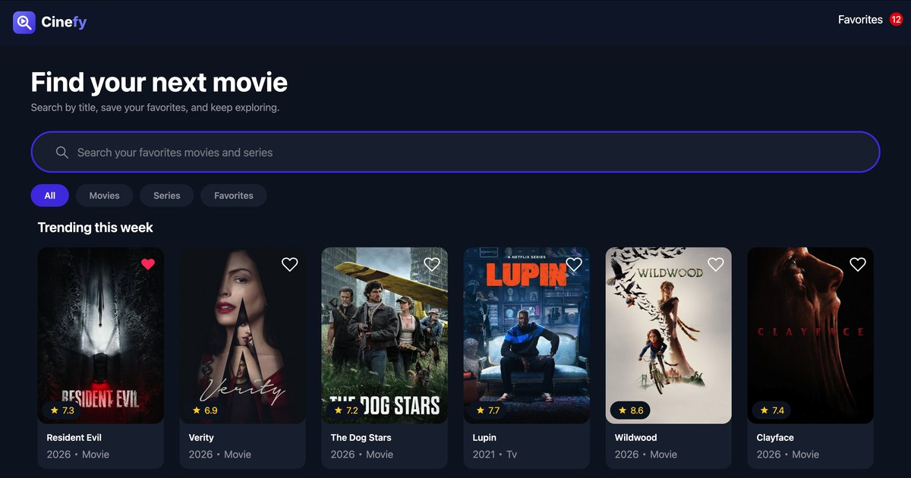
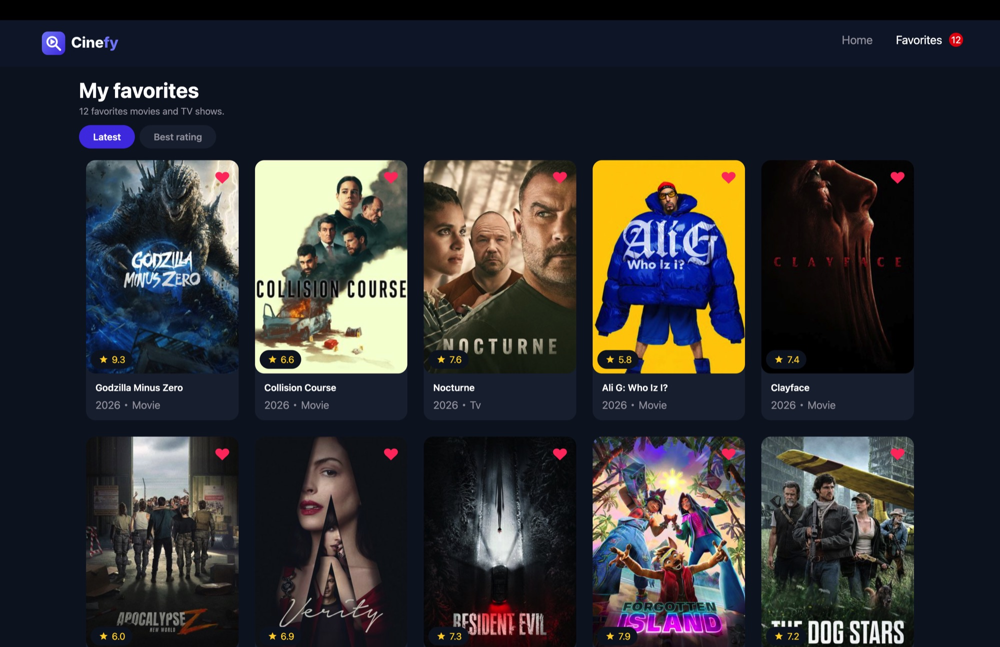
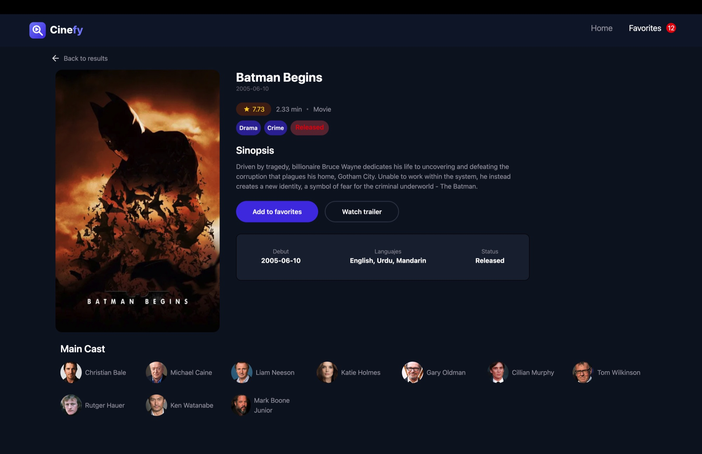
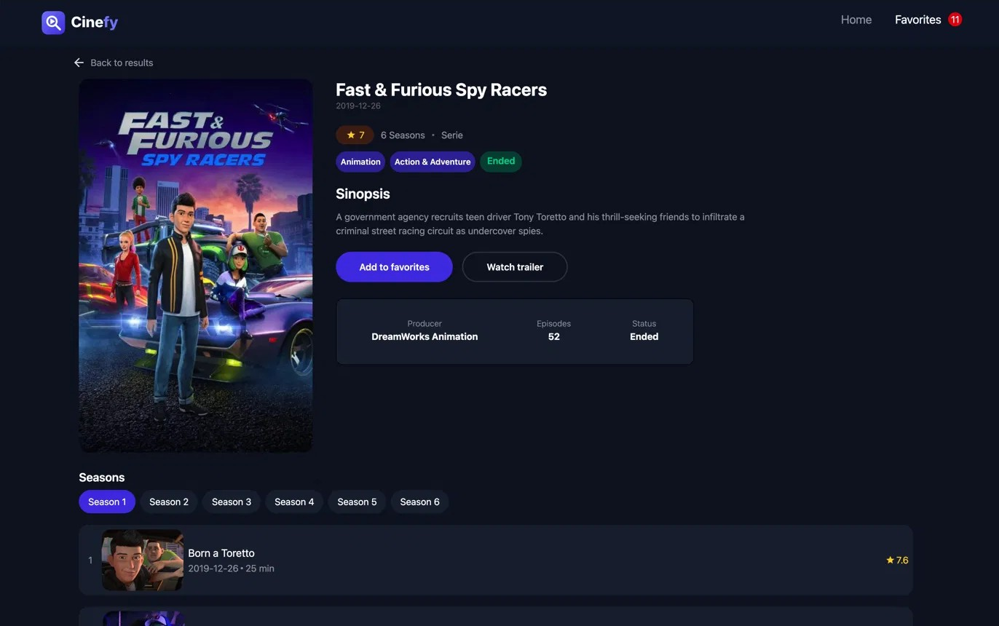
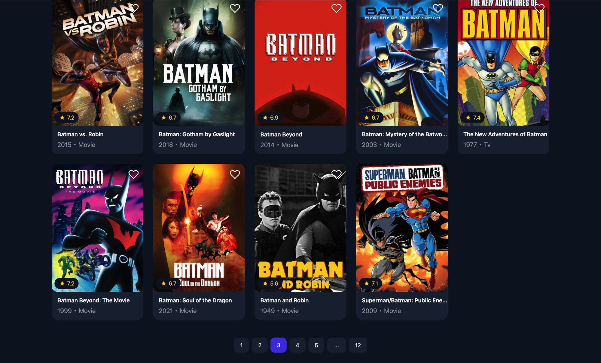

# Cinefy

A movie and TV show discovery app built with React, TypeScript and Tailwind CSS. Search trending titles, explore cast and seasons, and save your favorites locally.



[](https://react.dev)
[](https://www.typescriptlang.org)
[](https://vite.dev)
[](https://tailwindcss.com)

## Features

- **Trending & search** — shows TMDB's trending titles of the week and searches as you type (debounced 400 ms).
- **Filters** — switch between All, Movies, Series and Favorites.
- **Favorites** — toggle any title with the heart button. Persisted in `localStorage` and sortable by latest or best rating.
- **Details pages** — poster/backdrop hero, genres, rating, runtime, main cast, and seasons with episodes for TV shows.
- **Pagination** — accessible pagination for search results.
- **Saved query** — your last search is kept for the session (`sessionStorage`).
- **Polished UX** — loading skeletons, retryable error states, empty states and a custom 404 page.
- **Accessibility** — semantic HTML, `aria-label`/`aria-pressed`, keyboard-friendly controls and live regions.
- **Optimized images** — TMDB artwork is resized and compressed through [wsrv.nl](https://wsrv.nl).

## Screenshots

| Home | Favorites |
| --- | --- |
|  |  |

| Movie details | Series details |
| --- | --- |
|  |  |



## Tech stack

| Area | Tool |
| --- | --- |
| UI | React 19, React Router 7 |
| Language | TypeScript 6 |
| Build | Vite 8 |
| Styling | Tailwind CSS 4 |
| State | Zustand 5 (with `persist`) |
| Linting | ESLint 10 + `typescript-eslint` |
| Data | [TMDB API](https://developer.themoviedb.org/docs) |

## Getting started

### Prerequisites

- [Node.js](https://nodejs.org) 20+ (22 LTS recommended)
- [pnpm](https://pnpm.io)

### Installation

```bash
pnpm install
```

### Environment variables

Create a `.env` file in the project root (see `.env.example`):

```bash
VITE_TMDB_API_KEY=your_tmdb_read_access_token
```

The value must be a **TMDB API Read Access Token (v4)**, which is sent as a Bearer token. You can create one in your [TMDB account settings](https://www.themoviedb.org/settings/api).

### Development

```bash
pnpm dev
```

### Available scripts

| Script | Description |
| --- | --- |
| `pnpm dev` | Start the dev server with HMR |
| `pnpm build` | Type-check and build for production |
| `pnpm preview` | Preview the production build locally |
| `pnpm lint` | Run ESLint |

## Routes

| Path | Page | Description |
| --- | --- | --- |
| `/` | Home | Trending titles + debounced search with filters |
| `/search?q=&page=` | Results | Paginated multi-search results |
| `/details/:mediaType/:id/:title` | Details | Movie or TV details, cast and seasons |
| `/favorites` | Favorites | Saved titles with sorting |
| `*` | Not found | Custom 404 page |

## Project structure

```text
docs/                  # Screenshots used in this README
src/
├── assets/            # Logos, 404 illustration
├── components/
│   ├── details/       # Hero, cast, seasons, episodes + skeletons
│   ├── favorites/     # Favorites list and empty state
│   ├── home/          # Search, filters, result cards + skeletons
│   ├── layout/        # Header
│   └── ui/            # Reusable UI (buttons, pagination, error state, page fallback)
├── hooks/
│   ├── useFetch.ts    # Fetch with abort + retry
│   ├── useDebounce.ts
│   ├── useDelayedFlag.ts
│   ├── useFavorites.ts    # Zustand store (localStorage)
│   └── useSavedQuery.ts   # Zustand store (sessionStorage)
├── pages/             # Route-level components
├── types/
│   ├── tmdb/          # TMDB API types: common, search, movie, series
│   ├── favorites.ts   # Favorite, ResultCardProps, FavoritesState
│   ├── hero.ts        # HeroView
│   └── index.ts       # Barrel: import type { ... } from "@/types"
├── utils/             # Image optimization, public URL and data helpers
├── App.tsx            # Routes
└── main.tsx           # Entry point + router
```

## How it works

- **Data fetching** lives in `useFetch`, which aborts stale requests with `AbortController`, exposes `loading`/`error`/`data` and a `retry` function.
- **Favorites** are stored in a Zustand store persisted to `localStorage`, so they survive reloads. The header shows the live count.
- **The last search** is stored in a separate Zustand store backed by `sessionStorage`, and restored when you come back to the home page.
- **Image URLs** are wrapped by `optimizedImg` to request resized artwork from wsrv.nl.

## Deployment

The app is configured for GitHub Pages with `base: '/cinefy'` in `vite.config.ts`; the router's `basename` is derived from `import.meta.env.BASE_URL`, so no extra configuration is needed.

```bash
pnpm build
```

Publish the contents of `dist/` to your Pages branch (e.g. `gh-pages`). If you use client-side routing with deep links on Pages, add an SPA fallback (`404.html`) so refreshes on routes like `/details/...` resolve to `index.html`.

## Attribution

This product uses the TMDB API but is not endorsed or certified by [TMDB](https://www.themoviedb.org).
